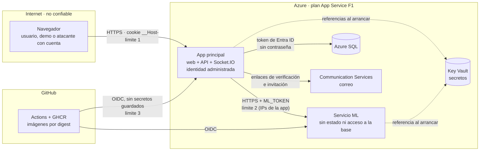

# Modelo de amenazas (STRIDE)

El riesgo principal de este sistema es **un usuario con cuenta que abusa de lo que la app le permite**, no un atacante externo sin acceso: registrarse es gratis y la demo es pública. Por eso los controles más importantes están en la autorización por tablero, en los límites de uso y en que todo falle cerrado. Los 26 hallazgos de la auditoría están corregidos; los riesgos que quedan se aceptan de forma explícita al final, con su motivo.

Cómo se prueba cada control: [plan-de-pruebas.md](plan-de-pruebas.md). Cómo reportar una vulnerabilidad: [SECURITY.md](../SECURITY.md).

## Sistema y límites de confianza

| Límite | Qué cruza | Control principal |
|---|---|---|
| 1 · Navegador → app | Todo lo que escribe un usuario, incluido el socket | Sesión en cookie `__Host-` HttpOnly, Secure y SameSite; validación con Zod; permisos por tablero en REST y en el socket |
| 2 · App → ML | Datos de un tablero ya autorizados | `ML_TOKEN` de 32 caracteres o más; restricción de acceso a las IPs de salida de la app; respuesta validada |
| 3 · GitHub → Azure | Imágenes nuevas | OIDC con una credencial federada atada al repo (por id) y al entorno `produccion`; rol mínimo sobre las dos apps |
| App → SQL y Key Vault | Datos y secretos | Identidad administrada; la app solo lee y escribe datos (sin DDL) y solo lee sus propios secretos |

## Activos

| Activo | Por qué importa |
|---|---|
| `JWT_SECRET` | Con él se firman sesiones de cualquier usuario |
| Datos de los tableros | Son privados de sus miembros |
| Contraseñas | Solo se guarda el hash bcrypt (12 rondas) |
| `ML_TOKEN` | Abre el servicio de análisis, que consume CPU |
| Cuota de CPU del plan F1 | 60 minutos al día: si se agota, el sitio se detiene |
| Acceso a la base | La app no tiene contraseña; la del administrador vive solo en Key Vault |
| Cadena de despliegue | Quien publique una imagen controla producción |
| Reputación del remitente de correo | Un abuso puede bloquear el envío de verificaciones |

## Amenazas y mitigaciones

| STRIDE | Amenaza | Mitigación | Hallazgo |
|---|---|---|---|
| **S**uplantación | Falsificar una sesión con un secreto conocido | Secreto de 32 caracteres o más; se rechazan los de ejemplo y las referencias de Key Vault sin resolver | S-13 |
| **S**uplantación | Adivinar contraseñas | Límite por IP real (10 por minuto) y por cuenta (5 intentos libres, luego esperas de hasta 15 min); lista de contraseñas comunes | S-02, S-17 |
| **S**uplantación | Registrar el correo de otra persona para recibir sus invitaciones | Verificación por correo; sin verificar no se ven invitaciones | S-09 |
| **S**uplantación | Abrir un WebSocket desde otro sitio con la cookie de la víctima | El handshake rechaza otros `Origin` | S-15 |
| **S**uplantación | Robar la identidad del CI desde otro repositorio | El subject OIDC usa los ids del dueño y del repo, no el nombre | — |
| **T**ampering | Mover tarjetas a un tablero ajeno | La API valida que la columna destino sea del mismo tablero | — |
| **T**ampering | Corromper el orden con movimientos simultáneos | Bloqueo por columna, reequilibrio de claves y reintento ante conflicto | S-20 |
| **T**ampering | Imagen o dependencia alterada | Actions por SHA, bases por digest, pip con hashes, procedencia firmada, despliegue por digest | S-23 |
| **R**epudio | Negar un cambio en un tablero | Parcial: `CardEvent` guarda qué cambió y cuándo, en la misma transacción, pero no quién (riesgo aceptado) | — |
| **I**nformación | Saber si un correo está registrado | Login e invitaciones responden lo mismo exista o no la cuenta | S-08 |
| **I**nformación | Ver un tablero ajeno | 404 (no 403) para quien no es miembro; el socket exige membresía | — |
| **I**nformación | Detalles internos en los errores | Mensaje genérico al cliente; el detalle solo en el log, con cookie y cabeceras de auth censuradas | — |
| **I**nformación | Secretos en el repo o en la imagen | gitleaks en cada PR; `.dockerignore` con patrones de secretos; secretos en Key Vault | S-03, S-24, S-25 |
| **I**nformación | Leer el esquema del ML | Sin `/docs` ni `/openapi.json` en producción | S-07 |
| **D**enegación | Tumbar el proceso con un evento malformado | Validación y captura de errores en cada evento del socket | S-01 |
| **D**enegación | Agotar la CPU con métricas o análisis enormes | Caché, 5 cálculos por usuario y minuto, topes de entrada y algoritmos O(N log N) | S-05, S-22 |
| **D**enegación | Llenar la base de tarjetas y tableros | Cuotas por usuario y por tablero; ventanas deslizantes en el socket | S-16 |
| **D**enegación | Que la demo quede inutilizable | Demo sin permisos destructivos, reiniciada cada día | S-18 |
| **E**levación | Que un miembro actúe como dueño | Permisos por rol en cada ruta y evento; pruebas con dueño, miembro y no miembro | — |
| **E**levación | Seguir conectado tras ser expulsado o cerrar sesión | `sessionVersion` revoca el token; el socket se corta; la membresía se comprueba otra vez tras `join` | S-10, S-21 |
| **E**levación | Ocultar cambios a otros con `x-socket-id` | Solo se excluye un socket del mismo usuario | S-14 |
| **E**levación | Que la app modifique el esquema o lea secretos ajenos | Rol `db_datareader` + `db_datawriter`; cada app lee solo sus secretos | S-04 |
| **E**levación | Que el CI haga más de lo necesario | `GITHUB_TOKEN` de solo lectura salvo en publicar y desplegar; la identidad de despliegue solo administra las dos apps | S-12 |

## Riesgos aceptados

Lo que queda, por qué se acepta y qué lo haría cambiar.

| Riesgo | Por qué se acepta | Lo cambiaría |
|---|---|---|
| Las IPs de salida del plan F1 se comparten con otros clientes de Azure, así que las reglas del firewall de SQL y del ML no aíslan del todo | El plan gratuito no tiene red virtual ni IPs propias. La barrera real sigue siendo la autenticación: token de Entra en SQL y `ML_TOKEN` en el ML | Pasar a un plan con integración de red virtual y endpoints privados |
| SQL sigue aceptando el login administrador, que usan las migraciones | Prisma Migrate necesita un usuario con DDL. La contraseña está solo en Key Vault y el firewall solo se abre durante la migración | Migraciones con una identidad de Entra y SQL con autenticación solo de Entra |
| Una persona con muchas cuentas o IPs puede agotar la cuota diaria de CPU del F1 | Los límites encarecen el ataque, pero no lo impiden. Si pasa, el sitio se detiene hasta el día siguiente; no se pierden ni se exponen datos | Un plan pago con escalado, o un WAF delante |
| El JWT dura 7 días sin rotación | Se puede revocar al instante (`sessionVersion`) y vive en una cookie HttpOnly | Tokens cortos con renovación |
| Las cuotas y límites viven en la memoria del proceso | Hay una sola instancia. Un reinicio solo los pone en cero | Un almacén compartido (Redis) al escalar a varias instancias |
| No queda registro de quién hizo cada cambio | Es un tablero colaborativo sin requisitos de auditoría; los eventos existen para las métricas | Agregar el usuario a `CardEvent` |
| La carrera entre `board:join` y la expulsión no tiene una prueba determinista | Se corrigió comprobando de nuevo la membresía y se revisó a mano | Una prueba con un punto de pausa inyectado |

## Supuestos

- Azure termina TLS y agrega exactamente una entrada a `X-Forwarded-For`. Si se agrega otro proxy delante, hay que ajustar `TRUST_PROXY_HOPS`.
- Solo el dueño del repositorio puede fusionar a `main`, y la protección de rama exige los 11 checks en verde, también para él.
- La persona que opera Azure usa Cloud Shell y no copia secretos al chat ni a la terminal (los scripts los leen de Key Vault sin mostrarlos).

Este documento se revisa cuando cambia un límite de confianza: un servicio nuevo, otro tipo de usuario, otro plan de Azure o un cambio en cómo se despliega.
